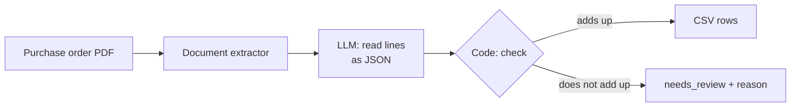
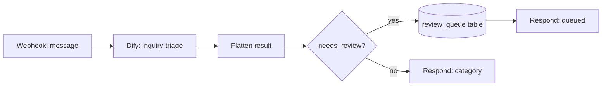

# dify-business-ai

[](https://github.com/yahayuta/dify-business-ai/actions/workflows/ci.yml)

Business AI apps built with **[Dify](https://dify.ai)**, designed so that people can rely on
what they produce: the LLM does the reading, and plain code checks its answer before
anything reaches a business system. Includes **measured** accuracy from runs on Dify Cloud.

All companies, products, orders and messages are invented.

## The apps

| App (Dify DSL) | What it does | What keeps it trustworthy |
|---|---|---|
| [`order-sheet-extractor`](dify/order-sheet-extractor.yml) | Reads a supplier purchase order (PDF) and returns the line items as CSV rows ready to import | Recalculates every line and the total, checks each SKU really appears on the sheet, normalises full-width digits, and flags anything that does not add up |
| [`inquiry-triage`](dify/inquiry-triage.yml) | Routes a customer message to one of seven categories, extracts the order ID and reads the sentiment | Validates labels against the schema, normalises order IDs (`#10234` → `ORD-10234`) and flags any order ID that is not in the message |



Both apps follow the same rule: **the LLM proposes, code verifies, people decide the
exceptions.** Every output carries `needs_review` and a human-readable `issues` string, so
the next step (a person, a review queue, an import job) knows what to trust.

## Measured results

### inquiry-triage: 40 labelled tickets

Real runs on Dify Cloud. Same prompt and validation code; only the model was changed.
Re-generate with `python evals/score.py`; the full report with every failed case is in
[`evals/report.md`](evals/report.md).

| Model | Graded | Accuracy | category | order_id | sentiment | p50 latency | Median tokens |
|---|---|---|---|---|---|---|---|
| `gemini-3.5-flash` | 40 | **97.5%** | 97.5% | 100.0% | 100.0% | 3.2 s | ~780 |
| `gpt-5.4-mini` | 39* | **89.7%** | 92.3% | 100.0% | 97.4% | 1.6 s | ~420 |

\* The 40th case did not run because the Dify Cloud trial credits ran out; it is reported
as "not run", not as wrong. Measured on 2026-10-12.

What the numbers show:

- **The checks did their job.** Neither model produced invalid JSON, an unknown label or an
  invented order ID across 79 runs, so nothing was flagged without reason.
- **The misses are judgement calls, not format errors.** Both models routed
  "Could you send me an invoice?" to `order_status` instead of `payment_issue`. That points
  the next change at the category rules in the prompt, not at the model.
- **It is a trade-off, not a winner.** Gemini was more accurate on this set; GPT answered
  in half the time with half the tokens. Which one to ship depends on volume and on the
  cost of a wrong route, and that is a decision to make with the team that owns the queue.

### order-sheet-extractor: 3 sample orders

| Sample | What is special | Result |
|---|---|---|
| `po_01_standard.pdf` | Clean sheet, 3 lines | 3 lines, total 71,280 matches, no review |
| `po_02_total_mismatch.pdf` | Stated total is wrong on purpose | Lines add up to 120,000, sheet says 125,000 → **flagged for review** |
| `po_03_fullwidth.pdf` | Full-width digits and SKUs (`ＢＴＬ－５００`, `２，４００`) | Normalised to `BTL-500`, `2400`; total matches |

Run on Dify Cloud with `gemini-3.5-flash` (4 to 7 seconds per sheet). The sample PDFs are
generated by [`scripts/make_order_sheets.py`](scripts/make_order_sheets.py) and the expected
values are in [`samples/order_sheets/expected.json`](samples/order_sheets/expected.json).

### n8n: routing real requests through the triage app

[`n8n/inquiry-triage-router.json`](n8n/inquiry-triage-router.json) puts the triage app behind a
webhook: the message goes to Dify, and anything with `needs_review` is written to an n8n data
table (`review_queue`) instead of being routed automatically.



Run on n8n Cloud against the published Dify app (8 messages,
[`n8n/run_2026-10-12.json`](n8n/run_2026-10-12.json)):

| Message | Routed to | Why |
|---|---|---|
| `where is my order ORD-10234?` | `order_status` | |
| `...refund. Order 10877.` | `return_refund` | `10877` normalised to `ORD-10877` |
| `Same problem as my last order...` | `complaint` | no order ID, none invented |
| `Where is my order ORD-1O234?` (letter O) | **review queue** | the model "fixed" the ID to `ORD-10234`, which is not in the message |
| `Order number is twelve thousand three hundred and forty five...` | **review queue** | `ORD-12345` was inferred from words, not copied |

The two review cases are exactly the ones a person should look at: the model's guess may well
be right, but nothing in the message proves it. Responses took 4 to 7 seconds end to end.
A Dify failure (non-`succeeded` status) is also sent to the review queue rather than dropped.

To use it: import the JSON into n8n, create a **Header Auth** credential with name
`Authorization` and value `Bearer <Dify app API key>`, select it in the Dify node, and create a
data table `review_queue` with string columns `message, category, order_id, sentiment, issues,
dify_run_id`.

## Use the apps

1. In Dify, **Create app → Import DSL file** and choose a file from `dify/`.
2. Pick a model you have access to in the LLM node (the files use `gemini-3.5-flash`).
3. Run it from the editor, or **Publish** and call it through the API.

Both files were imported into Dify Cloud (DSL version 0.7.0) and run there to produce the results above.

## Evaluate with your own key

```bash
export DIFY_API_KEY=app-...                      # API key of the published inquiry-triage app
python evals/run_dify.py --label my-model        # writes evals/runs/my-model.json
python evals/score.py                            # updates evals/report.md
```

The labelled tickets are the same ones used in
[business-ai-evals](https://github.com/yahayuta/business-ai-evals), so results can be compared
with other prompts and models.

## Tests

```bash
pip install -r requirements-dev.txt
pytest -q
```

The code nodes are tested **straight from the DSL files**: the tests load the YAML that is
imported into Dify and run the embedded Python, so what is tested is exactly what runs.
They cover schema validation, invented order IDs, markdown-wrapped JSON, total mismatches,
full-width numbers, SKUs that are not on the sheet and line amounts that do not equal
quantity × price, plus checks that every DSL graph and the n8n workflow are fully connected
and that no API key is in the exported workflow. CI also re-scores
the recorded runs.

## Repository layout

```
dify/       Dify apps (DSL 0.7.0)
evals/      labelled tickets, recorded runs, run_dify.py, score.py, report.md
n8n/        webhook workflow that routes messages through the triage app, and its recorded run
samples/    generated purchase-order PDFs, expected values and the recorded run
scripts/    sample generator
tests/      tests for the code nodes and DSL structure
```

## License

MIT
